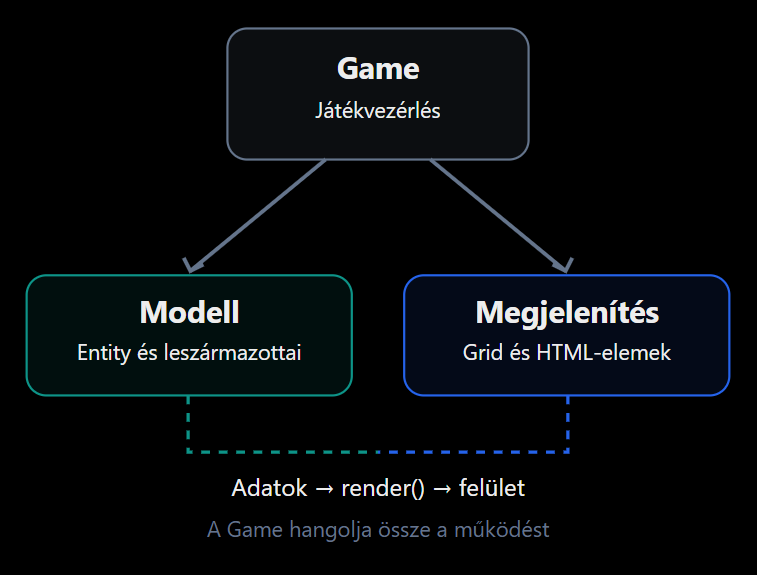
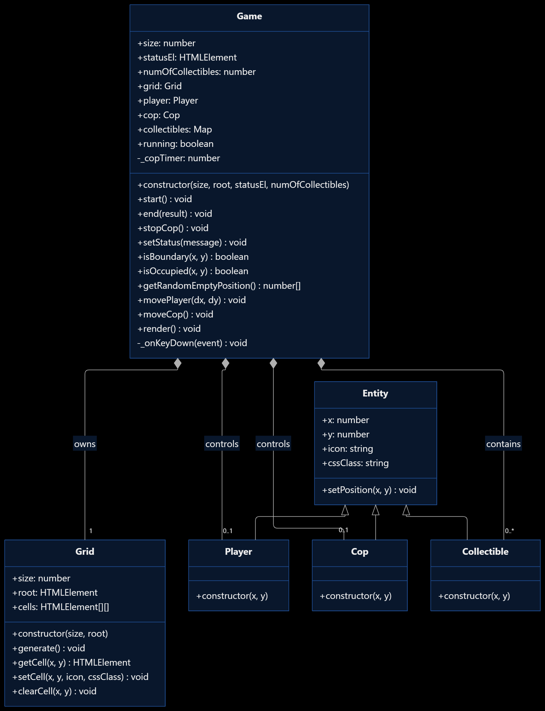

# Hasznos dolgok az órai kódra építve

Összeszedek néhány fontos/érdekes dolgot, amik arra épülnek, amit órán néztünk, és hasznosak lehetnek, ha valamilyen `grid-based` projekten dolgoztok (például a beadandó).

## Tömbök létrehozása - Array.from()

Nyugodtan használhattok `Array.from()`-ot ha szeretnétek tömböket létrehozni. Ez akkor működik, ha _tömbszerű_ vagy _iterálható_ értékekből akarunk új tömböt. Különösen hasznos, ha meghatározott méretű tömbbel kívánunk dolgozni, amit szeretnénk inicializáláskor feltölteni:

```js
// PÉLDA - 1
const numbers = Array.from({ length: 5 }, () => 0);
// { length: 5 } --> meghatározza az új tömb hosszát
// () => 0 --> map function, minden elemhez hozzárendeli az adott értéket

console.log(numbers);
// [0, 0, 0, 0, 0]

// PÉLDA - 2
const numbers = Array.from({ length: 5 }, (_, index) => index);

console.log(numbers);
// [0, 1, 2, 3, 4]
```

Alternatív módon az alábbit is csinálhatnám:

```js
const nums = Array(5).fill(0);
// itt azt mondom, kérek egy 5-elemű tömböt: Array(5), amit feltöltök nullákkal: fill(0)
```

Még az elején beszéltünk arról, hogy JS-ben, amikor mátrixot mondunk, valójában tömbök tömbjére gondolunk:

```js
const matrix = [
  [1, 2, 3],
  [4, 5, 6],
  [7, 8, 9],
];
```

Alapvetően - és nyilván ezt mindenki tudja - két for-ciklussan szoktunk ilyen "mátrixokat" létrehozni:

```js
const matrix = [];

for (let i = 0; i < 3; i++) {
  matrix.push([]);

  for (let j = 0; j < 3; j++) {
    matrix[i].push(0);
  }
}

/*
[
  [0, 0, 0],
  [0, 0, 0],
  [0, 0, 0]
]
*/
```

Ugyanez `Array.from()` használatával:

```js
const matrix = Array.from({ length: 3 }, () => Array(3).fill(0));

/*
[
  [0, 0, 0],
  [0, 0, 0],
  [0, 0, 0]
]
*/
```

## Spread operátor és destrukturálás

A játékban a véletlenszerű pozíciókat előállító metódus egy kételemű tömböt ad vissza:

```js
// ...
return [x, y];
```

Ezeket az értékeket többféleképpen használhatjuk:

```js
const position = [3, 7]; // a position változó egy kételemű tömb, position[0] = 3, position[1] = 7

// a destruktuálás lehetővé teszi, hogy egy tömb elemeit egyetlen utastással külön változókba helyezzük:
const [x, y] = position; // mivel a position egy kételemű tömb, "kicsomagolom" egy x és egy y változóba
console.log(x); // 3
console.log(y); // 7

// ez egyébként működik objektumokra is:
const person = {
  name: "Matyi",
  age: 24,
  hasStrava: true,
  greet: () function {
    console.log("Hello, az én nevem: ", this.name);
  }
};

// mintha azt mondanám, hogy kérem a person objectből ezt a két értéket:
const { name, age } = person;
console.log(name); // Matyi
console.log(age); // 24

/* ez ekvivalens azzal, mintha ezt mondanám:
const name = person.name;
const age = person.age;
console.log(name);
console.log(age);
*/
```

A `spread` syntax segítségével egy tömb elemeit - azon felül, amit már láttunk korábban - átadhatjuk külön argumentumként egy függvénynek. Ebben a játékban ezt így használjuk a pozíciók random generálásakor:

```js
function add(a, b) {
  return a + b;
}

const numbers = [5, 8];

console.log(add(...numbers)); // 13

// olyan, mintha azt mondanám:
// add(numbers[0], numbers[1]);
```

## Map

A `Map` _kulcs-érték_ párokat tárol. Hagyományos tömb esetén általában indexek alapján érjük el az elemeket. A `Map` nagy előnye a mi esetünkben itt, hogy a kulcsokkal können le tudjuk kérdezni, hogy létezik-e bizonyos elem, illetve gyorsan és hatékonyan kérhetjük azt el. Lásd: _algo tárgy_

```js
const students = new Map();

students.set("anna", 5); // első paraméter: kulcs, második paraméter: érték
students.set("bela", 4);

console.log(students.get("anna")); // 5
console.log(students.has("bela")); // true

students.delete("bela"); // töröljük a "bela" kulcson lévő elemet

/* Legfontosabb metódusok:
set(key, value)   --> Elem hozzáadása vagy módosítása
get(key)          --> Érték lekérdezése
has(key)          --> Kulcs létezésének ellenőrzése
delete(key)       --> Elem törlése
clear()           --> Összes elem törlése
values()          --> Tárolt értékek bejárása, visszaadja az értékeket tömbként
size              --> Elemek száma (tulajdonság)
*/
```

## Időzítők

A játék továbbfejlesztése során szükségünk lehet _időben késleltetett_ vagy _rendszeresen ismétlődő_ műveletekre. A JS ehhez két fontos idősítőfüggvényt biztosít:

- `setTimeout()` - egy függvényt egyszer hajt végre meghatározott késleltetés után.
- `setInterval()` - egy függvényt ismétlődően hív meg meghatározott időközönként.

Mindkét függvénnyel _ezredmásodpercben_ adhatjuk meg az időt, tehát `1000 ms = 1 s`

### setTimeout() - egyszeri késleltetés

```js
console.log("Játék indítása");

setTimeout(() => {
  console.log("Eltelt 3 másodperc!");
}, 3000);

console.log("A program tovább fut");
```

A program először tehát kiírja a játék indítását, majd a "program tovább fut" üzenetet. A késleltetett üzenet csak később jelenik meg. **Fontos**, hogy a `setTimeout()` nem állítja meg a teljes program futását.

### setInterval() - ismétlődő végrehajtás

```js
setInterval(() => {
  console.log("Eltelt egy másodperc");
}, 1000);
```

A függvény körülbelül másodpercenként kiír egy üzenetet. Ezt később felhasználhatjuk például arra, hogy tudjuk a rendőrt mozgatni automatikusan:

```js
this.copTimer = setInterval(() => {
  this.moveCop(); // lépjen a rendőr
  this.render(); // rajzoljuk újra a pályát
}, 1000);
```

A `setInterval` visszatérési értéke eltárolható, majd felhasználható az időzítő leállítására/megszűntetésére:

```js
const timer = setInterval(() => {
  console.log("Ketyeg...");
}, 1000);

clearInterval(timer);
```

A játékban például a végén leállíthatjuk majd a rendőr mozgását:

```js
stop() {
  this.running = false;
  clearInterval(this.copTimer);
  this.copTimer = null;
}
```

# Maci-Laci





A gyakorlaton a "jól ismer" Maci-Laci játékot fogjuk elkészíteni. Az alap cél, hogy dinamikusan le tudjuk generálni a játéktáblát, a játékos képes legyen lépkedni a táblán, pontokat tudjon gyűjteni azáltal, hogy összeszedi a lehelyezett objektumokat. Mindeközben pedig egy rendőr járőrözik a játéktáblán, másodpercneként lépve egyet. Ha Maci-Laci és a rendőr találkoznak, akkor a játék végetér vereséggel. Ha begyűjötttük az összes objektumot, akkor pedig mi győztünk!

## Entitások

Hozzunk létre egy `Entity` base class-t, amit az entitások fölé helyezünk. Ez rendelkezzen az alábbi adatagokkal és metódusokkal:

Adattagok:

- `x` és `y` koordináták: az entitás pozícióját jelölik a játéktáblán.
- `icon`: a karakter szimbóluma, amit megjelenítünk a táblán.
- `cssClass`: a karakterhez tartozó CSS osztály neve, amit a stílusokhoz használunk.

A játékban a következő entitások vannak jelen:

- `Player` (Maci-Laci): a játékos karaktere, akit a felhasználó irányít a billentyűzet segítségével. `(0, 0, 🐻, player)`
- `Cop` (Rendőr): automatikusan mozog a játéktáblán, és ha találkozik a játékkal, akkor végetér a játék. `(0, 0, 🚔, cop)`
- `Collectible` (Gyűjthető objektum): olyan tárgyak, amelyeket a játékos összegyűjthet, hogy pontokat szerezzen. `(0, 0, 🍯, collectible)`

Metódusok:

- `setPosition(x, y)`: egy metódus, ami beállítja az entitás pozícióját a megadott koordinátákra.

Származzunk le ebből a class-ból a `Player`, `Cop` és `Collectible` osztályokat, és mindegyikben definiáljuk a saját specifikus tulajdonságokat és viselkedést.

## Grid

Készítsünk egy `Grid` osztályt, ami a játéktáblát reprezentálja. Az osztály az alábbi adattagokat és metódusokat tartalmazza:

Adattagok:

- `size`: a tábla mérete (például 10x10 esetén 10). --> paraméterből állítjuk be
- `root`: a DOM elem, amiben a tábla megjelenik. --> paraméterből állítjuk be
- `cells`: egy kétdimenziós tömb, ami a tábla celláit reprezentálja. --> legeneráljuk, ehhez használjuk az `Array.from()` metódust megfelelő mérettel és mapping functionnel!

```js
class Grid {
  constructor(size, root) {
    // ...
  }
}
```

Metódusok:

- `generate()`: egy metódus, ami létrehozza a tábla HTML struktúráját a `root` elemben.
- `getCell(x, y)`: egy metódus, ami visszaadja a cella DOM elemét a megadott koordináták alapján.
- `setCell(x, y, icon, cssClass)`: egy metódus, ami beállítja a cella tartalmát és stílusát a megadott koordináták alapján.
- `clearCell(x, y)`: egy metódus, ami törli a cella tartalmát és stílusát a megadott koordináták alapján.

### 1.

Írjuk meg a konstruktort megfelelően, ne felejtsük el meghívni a `generate()` metódust a tábla létrehozásához.

### 2.

Implementáljuk a `generate()` metódust, ennek a lépései nagyjából:

- "Ürítsük ki" a `root` elemet.
- Generáljunk le egy `size x size` méretű táblát, ehhez érdemes most az alábbi kódot használni:

```js
this.root.style.gridTemplateColumns = `repeat(${this.size}, 30px)`;
this.root.style.gridTemplateRows = `repeat(${this.size}, 30px)`;

// Itt "CSS Grid instructions" van használatban, ami a "display: grid" stílus miatt megfelelően le fog generálni
// 10 darab sort és 10 darab oszlopot, mindegyik 30 pixel széles és magas lesz. Nyilván működne az is, ha táblázatot
// hozunk létre, de a CSS Grid sokkal kényelmesebb és modernebb megoldás erre most.
```

- Generáljunk `size * size` darab `div` elemet, amik a cellák lesznek, adjuk hozzájuk a `cell` stílusosztályt, appendeljük a `root` elemhez, és mentsük el őket a `cells` tömb megfelelő helyére.

### 3.

Implementáljuk a `clearCell()` metódust, itárjulnk végig a `cells` tömbön, minden cellát ürítsünk ki és tegyük rájuk vissza az alapértelmezett `cell` osztályt.

### 4.

Implementáljuk a `setCell(x, y, icon, cssClass)` metódust, ami a megadott koordinátájú cellát beállítja a megadott ikonra és css osztályra.

### 5.

Implementáljuk a `getCell(x, y)` metódust, ami visszaadja a megadott koordinátájú cella DOM elemét.

## Game

Készítsük el a `Game` osztályt, ami a játék logikáját kezeli, itt áll össze minden. Az osztály az alábbi adattagokat és metódusokat tartalmazza:

Adattagok:

PARAMÉTERBŐL ÁLLÍTJUK BE:

- `size`: a játéktábla mérete, hasonlóan a `Grid` osztályhoz.
- `statusElelement`: a DOM elem, amiben a játék állapotát jelenítjük meg (pl. pontszám, játék vége üzenet).
- `numCollectibles`: a gyűjthető objektumok száma a táblán.

ITT INCIALIZÁLJUK:

- `grid`: a `Grid` osztály egy példánya, ami a játéktáblát kezeli. --> ehhez kell egy `root` is, elkérjük paraméterként
- `player`: a `Player` osztály egy példánya, ami a játékost reprezentálja. --> kezdetben `null`
- `cop`: a `Cop` osztály egy példánya, ami a rendőrt reprezentálja. --> kezdetben `null`
- `collectibles`: egy Map, ami a gyűjthető objektumokat tárolja a pozíciójuk alapján készített kulccsal, pl `${}x}-${y}`.
- `running`: egy boolean érték, ami jelzi, hogy a játék folyamatban van-e.
- `_copTimer`: egy privát adattag, ami a rendőr mozgását vezérlő időzítőt tárolja.

```js
class Game {
  constructor(size, root, statusEl, numOfCollectibles) {
    //...
  }
}
```

Metódusok:

- `start()`: egy metódus, ami elindítja a játékot, inicializálja a játéktáblát, elhelyezi az entitásokat, és beállítja a billentyűzet eseménykezelőket.
- `end(result)`: egy metódus, ami befejezi a játékot, megállítja a rendőr mozgását, és frissíti a játék állapotát a megadott eredménnyel (pl. "win" vagy "lose").
- `stopCop()`: egy metódus, ami megállítja a rendőr mozgását.
- `setStatus(message)`: egy metódus, ami frissíti a játék állapotát a megadott üzenettel.
- `isBoundary(x, y)`: egy metódus, ami ellenőrzi, hogy a megadott koordináták a játéktábla határain belül vannak-e.
- `isOccupied(x, y)`: egy metódus, ami ellenőrzi, hogy a megadott koordinátákon van-e már entitás (játékos, rendőr vagy gyűjthető objektum).
- `getRandomEmptyPosition()`: egy metódus, ami visszaad egy véletlenszerűen kiválasztott üres pozíciót a játéktáblán.
- `movePlayer(dx, dy)`: egy metódus, ami megpróbálja elmozdítani a játékost a megadott irányba (dx, dy), és kezeli az ütközéseket a gyűjthető objektumokkal és a rendőrrel.
- `moveCop()`: egy metódus, ami véletlenszerűen elmozdítja a rendőrt egy szomszédos cellába, és kezeli az ütközést a játékkal.
- `render()`: egy metódus, ami frissíti a játéktábla megjelenítését az aktuális entitások pozíciói alapján.
- `_onKeyDown(event)`: egy privát metódus, ami kezeli a billentyűzet eseményeket, és meghívja a `movePlayer()` metódust a megfelelő irányba.

### 1.

Írjuk meg a konstruktort megfelelően, ne felejtsük el inicializálni a `grid` példányt és a `collectibles` Map-et. A `running` értékét állítsuk `false`-ra, a `_copTimer` értékét pedig `null`-ra.

### 2.

Implementáljuk az `isOccupied(x, y)` metódust, ami ellenőrzi, hogy a megadott koordinátán van-e már entitás. (Pl: ha van player, és a megadott x, y megegyezik a player x, y értékkel, akkor true-t ad vissza. a Map esetén egyszerűen ellenőrizzük, van-e ilyen kulcs a Map-ben)

### 3.

Implementáljuk a `getRandomEmptyPosition()` metódust, ami véletlenszerűen generál x és y értékeket a tábla méretén belül, és addig ismétli ezt, amíg nem talál egy üres pozíciót (az `isOccupied()` metódus segítségével).

```js
Math.floor(Math.random() * this.size);
```

### 4.

Implementáljuk a `render()` metódust, ami először meghívja a `grid.clearCell()` metódust, majd beállítja a player, cop és collectibles pozícióit a `grid.setCell()` metódus segítségével. Ez alatt azt értjük, hogy a játéktábla azon celláit, amiken játékos, rendőr vagy gyűjthető objektum áll, felülírjuk az alap, `generate()`-es feltöltést! (for...of ciklussal végigmehetünk a Map-en is!)

### 5.

Implementáljuk a `start()` metódust, ami elindítja a játékot:

- **KIKOMMENTELVE - TODO**: hívjuk meg a `stopCop()` metódust
- Állítsuk a `running` értékét `true`-ra.
- Ürítsük ki a `collectibles` Map-et.
- Ürítsük ki a `grid`-et.
- Hozzuk létre a `player` és `cop` entitásokat véletlenszerű pozíciókkal (a `getRandomEmptyPosition()` metódus segítségével).
- Hozzuk létre a `numCollectibles` darab `Collectible` entitást véletlenszerű pozíciókkal, és mentsük el őket a `collectibles` Map-be. (set metódus segítségével tudunk hozzáadni értékeket a Map-hez)
- **TODO**: Állítsuk be a `_copTimer` értékét egy `setInterval()` hívással, ami másodpercenként meghívja a `moveCop()` metódust. (egyelőre csak írjunk egy console.log-ot a moveCop metódusba)
- Adjunk a window objektumhoz egy `keydown` eseményhallgatót, ami a `_onKeyDown()` metódust hívja meg, egyelőre itt is csak egy console.log-ot írjunk ki az esemény objektumból.
- **TODO: this.setStatus()?**: Állítsuk be a státusz elemet egy kezdő üzenetre, pl "Játék elkezdődött!".
- Hívjuk meg a `render()` metódust a kezdeti állapot megjelenítéséhez.

### 6.

Indítsuk el a játékot:

- kérjük meg a `start gombot`, a `gridet`, a `státusz elemet`, példányosítsunk egy `Game` objektumot, adjunk a `start gomb` `click` eseményéhez egy eseményhallgatót, ami meghívja a `game.start()` metódust.

### 7.

Írjuk meg az `_onKeyDown(e)` metódust, itt a legegyszerűbb, ha egy `Map`-ben tároljuk a lenyomott kulcsokat és a hozzájuk tartozó `[dx, dy]` értékeket. Például:

```js
const keyMap = new Map([
  ["ArrowUp", [-1, 0]], // egy felfelé lépünk, stb
  ["ArrowDown", [1, 0]],
  ["ArrowLeft", [0, -1]],
  ["ArrowRight", [0, 1]],
]);
```

Ezt követően egyszerűen ellenőrízhetjük, hogy a lenyomott gomb (`e.key`) szerepel-e a `keyMap`-ben, ha igen, akkor `preventDefault()`-oljuk az eseményt, és hívjuk meg a `movePlayer(dx, dy)` metódust a megfelelő értékekkel.
**TODO**: `movePlayer`

### 8.

Írjuk meg a `movePlayer(dx, dy)` metódust, ami megpróbálja elmozdítani a játékost a megadott irányba:

- Ha nem megy a játék (ha `this.running` hamis), akkor térjünk vissza.
- Számoljuk ki az új pozíciókat: egyszerű matek, hozzáadjuk a delta értékeket, majd nézzük meg, hogy nem lépünk-e ki a táblából, ha igen, akkor térjünk ismételten vissza, ha nem, akkor állítsuk be a player új pozícióját.
  **TODO**: írjunk egy `isBoundary(x, y)` metódust, ami ellenőrzi, hogy a megadott koordináták a tábla határain belül vannak-e.
- Hívjuk meg a `render()` metódust a változások megjelenítéséhez.

Ellenőrízzük, hogy gyűjtöttünk-e be valamit:

- Ha van a `collectibles` Map-ben kulcs a játékos új pozícióján, akkor töröljük belőle (`delete()`), és frissítsük a státusz elemet, pl: `Felvettél egy kincset, hátra van: ${this.collectibles.size}`

- Ha a játékos összegyűjtötte az összes objektumot vagy pedig a rendőrrel egy pozícióban van, végetér a játék

**TODO**: írjuk meg az `end(result)` metódust, ami megállítja a játékot, leállítja a rendőr mozgását, leveszi az eseményhallgatót, az eredménytől függően pedig frissító a státuszelemet!

### 9.

Írjuk meg a `moveCop()` metódust, ami véletlenszerűen elmozdítja a rendőrt egy szomszédos cellába:

- Ha nem megy a játék (ha `this.running` hamis), akkor térjünk vissza.
- Tároljuk hasonlóan a lehetséges irányokat egy tömbben, mint a kulcsok az `_onKeyDown()` metódusban, innen fogunk véletlenszerűen generálni egy irányt
- Hozzunk létre egy `options` tömböt, ami már a lehetséges új pozíciókat tartalmazza: a `dirs` tömb minden eleméhez számoljuk ki az új pozíciót, majd szűrjük ki azokat, amik kilépnének a határokon.
- Ha maradt lehetséges lépése a rendőrnek, akkor véletlenszerűen generáljuk egy új elemet, ahol az index: `Math.floor(Math.random() * options.length)`, majd állítsuk be a rendőr új pozícióját.
- Hívjuk meg a `render()` metódust a változások megjelenítéséhez.

**TODO**: Ellenőrízzük, hogy a rendőr és a játékos egy pozícióban van-e, ha igen, akkor végetér a játék (hívjuk meg az `end("lose")` metódust).

### 10.

Írjuk meg a `stopCop()` metódust:

```js
  stopCop() {
    if (this._copTimer) {
      clearInterval(this._copTimer);
      this._copTimer = null;
    }
  }
```
